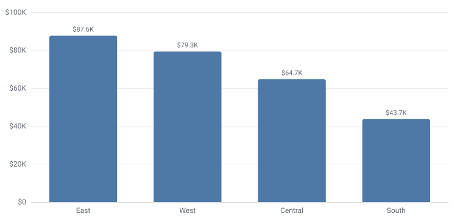
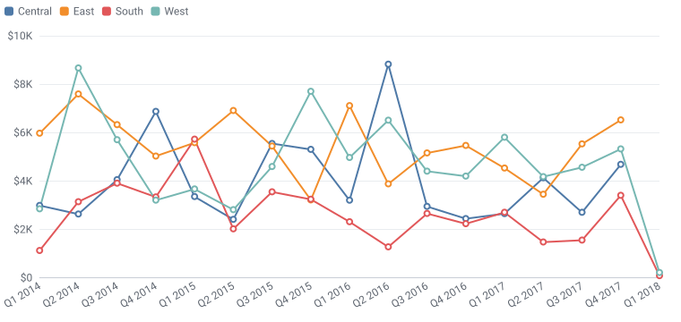
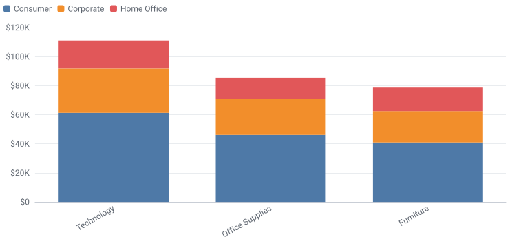
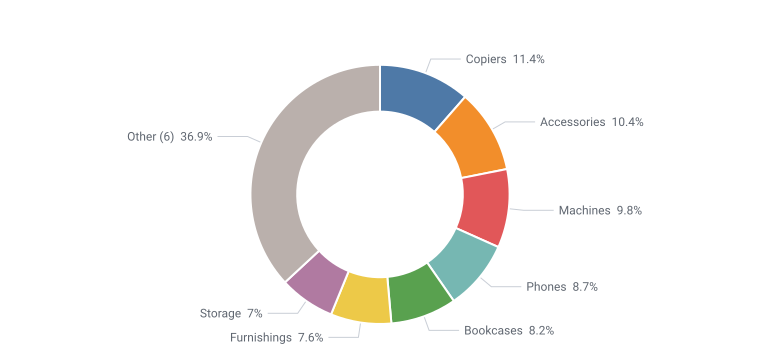
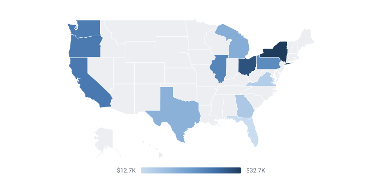
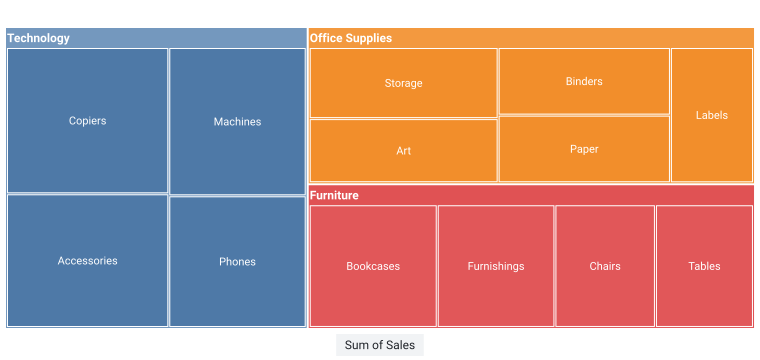
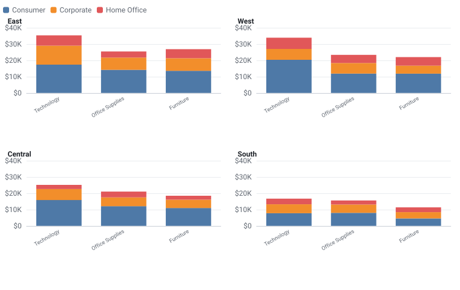
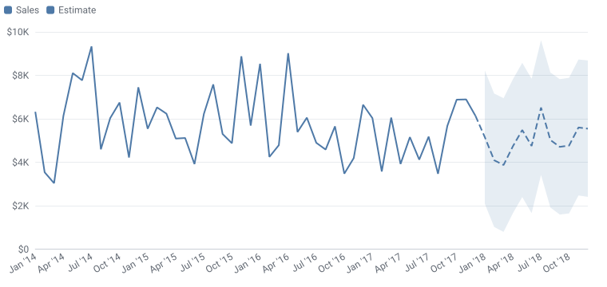

<p align="center">
  <picture>
    <source media="(prefers-color-scheme: dark)" srcset="docs/assets/logo-wordmark-dark.svg">
    
  </picture>
</p>

<p align="center">
  <b>BI-quality charts, world maps and dashboards from a pandas DataFrame.</b><br>
  Rule-based. No LLM. One offline HTML file.
</p>

<p align="center">
  <a href="https://github.com/yesh069/tabsight/actions/workflows/ci.yml"></a>
  <a href="https://github.com/yesh069/tabsight/actions/workflows/docs.yml"></a>
  
  
  
  
  <a href="https://github.com/sponsors/yesh069"></a>
</p>

---

Most chart tools take your columns at face value. They add up discounts, treat zip codes as numbers, smooth lines between real data points, and quietly average averages when someone filters a dashboard. The chart looks fine and the numbers are wrong.

tabsight starts one step earlier. It works out what each column actually is, tells you why it thinks so, keeps every number exact, and only then draws the chart, formatted the way a finance team would expect. The result is a single HTML file that opens in any browser, offline, with nothing to install on the other end.

<p align="center">
  
  
</p>
<p align="center">
  
  
</p>
<p align="center"><sub>Real output from <code>ts.chart</code> on the sample data in this repository, nothing edited by hand.</sub></p>

> **Status:** early development, not yet on PyPI. Install it from this repository (see [Install](#install)).

## A first look

```python
import tabsight as ts

orders = ts.load("examples/superstore_sample.csv")
print(ts.profile(orders))
```

```text title="Output"
Profile: 1,200 rows, 18 columns

Column        Role       Unit       Agg     Why
Row_ID        id         none       countd  name says it is an ID/code; never summed
Order_ID      id         none       countd  name says it is an ID/code
Order_Date    time       none       none    text that reads as dates; 100% parse as %m/%d/%Y
Ship_Date     time       none       none    text that reads as dates; 100% parse as %m/%d/%Y
Ship_Mode     dimension  none       none    categories
Customer_ID   id         none       countd  name says it is an ID/code
Segment       dimension  none       none    categories
Country       dimension  none       none    categories
City          dimension  none       none    categories
State         dimension  none       none    categories
Postal_Code   id         none       countd  name says it is an ID/code
Region        dimension  none       none    categories
Category      dimension  none       none    categories
Sub_Category  dimension  none       none    categories
Sales         measure    currency   sum     name suggests money
Quantity      measure    count      sum     name suggests a count
Discount      measure    percent    mean    name suggests a percentage; values stored as fractions (0.15 = 15%); averaged, because totals of rates/prices/scores are meaningless
Profit        measure    currency   sum     name suggests money

Hierarchies:
  Category -> Sub_Category
  Region -> City
  Region -> State
```

Nothing was configured. The IDs will never be added up, the discount will be averaged rather than summed, the dates were read as month-first because a value like `01/15` settles it, and tabsight noticed that every sub-category belongs to one category. Each of those decisions can be changed in one argument, and none of them touched `orders`.

From there it's one line to a chart:

```python
fig = ts.chart(orders, "bar", x="Region", y="Sales")
print(fig.title)
print(fig.option["series"][0]["data"])
```

```text title="Output"
Sum of Sales by Region
[87642.84, 79286.84, 64667.9, 43661.26]
```

```python
# not run
fig.to_html("sales_by_region.html")  # one file, opens offline in any browser
```

In Jupyter, a figure on the last line of a cell draws itself.

## What it does today

**Reads data carefully.** `ts.load` reads local files only. It detects Windows-1252 exports, keeps the leading zero in `02134`, and works out `;`-separated European CSVs. `ts.profile` assigns every column a role (dimension, measure, time, ID…), a unit (money, percent, count, duration) and a sensible way to summarise it, with a written reason for each.

**Checks and, if you want, cleans.** `ts.check` reports stray spaces, `West` versus `west`, placeholders like `N/A`, likely typos, dates before 1901 and ship dates before order dates, and changes nothing. `ts.clean` is optional. It fixes only what can't change meaning, suggests the rest, and every change can be undone or replayed on next month's file.

**Keeps the numbers exact.** `ts.aggregate` stores every summary in a form that can be recombined after filtering: a sum and a count for an average, the values themselves for a median. The average for "Other" is the true average of those rows, not an average of averages. Different currencies are never added together.

```python
margin = ts.calc("Margin = SUM(Profit) / SUM(Sales)")
by_category = ts.aggregate(orders, "Category", ["Sales", margin]).values
by_category["Margin"] = by_category["Margin"].map(lambda m: ts.format_number(m, "percent"))
print(by_category)
```

```text title="Output"
          Category      Sales Margin
0       Technology  111105.78   3.7%
1  Office Supplies   85475.89   3.7%
2        Furniture   78677.17   1.9%
```

**Formats like a business tool.** Every number is formatted by what it means, in 14 locales:

```python
for locale, currency in [("en_US", "USD"), ("de_DE", "EUR"), ("en_IN", "INR")]:
    print(
        locale,
        ts.format_number(1_234_567.5, "currency", "compact", locale=locale, currency=currency),
    )
```

```text title="Output"
en_US $1.2M
de_DE 1,2 Mio. €
en_IN ₹12.3L
```

**Draws 33 kinds of chart that follow the rules.** Bars, lines and areas, scatter and bubble, histograms and box plots, treemaps, sunbursts, waterfalls, funnels, Pareto, Sankey, heatmaps and calendars, bullets, gauges, combos, KPI cards, tables and four kinds of map, plus small multiples (`facet=`) that share one scale. Every label is readable, or the chart turns horizontal and tells you so. Lines are never smoothed, bars start at zero, the same region keeps the same colour in every chart, and a chart that ends on a half-finished month says so instead of implying a crash.

**Picks the chart, and tells you why.** `ts.recommend` ranks the charts that fit your fields and lists what it ruled out. `kind="auto"` draws the winner, `fig.explain()` lists every decision, and `fig.lint()` checks any chart, including one you changed by hand, against 17 design rules.

```python
print(ts.recommend(orders, x="Sub_Category", y="Discount"))
```

```text title="Output"
Charts for 1 category field, 1 measure:

   90  bar             a measure by category: bars, largest first, are easiest to compare
   80  hbar            horizontal bars work too, and suit longer labels
   50  lollipop        a lighter alternative to bars
   40  table           a table lists exact values

Ruled out:
       donut           these values are averages or distinct counts, which don't add up to a whole
       treemap         these values are averages or distinct counts, which don't add up to a whole
       line            a line implies an order between categories; use bars
```

A donut of average discounts would show shares of a total that doesn't exist, so it's ruled out. Rules, not a model: the same data always gets the same answer, and the rules are checked against 70 labelled cases.

**Draws maps of any country, offline.** Give it a column of places and it finds the map: countries, the states, provinces or counties of every country, or about 7,300 cities. Names match in about 25 languages and as ISO or postal codes. Ambiguous names like Georgia or Punjab are settled by the other values, and anything that doesn't match is reported with a suggestion, never dropped silently.

<p align="center">
  
</p>

```python
for values in (
    ["Bayern", "Hessen", "Sachsen"],
    ["England", "Scotland", "Wales"],
    ["CA", "TX", "NY"],
):
    print(ts.geo.detect(values).label)
```

```text title="Output"
Germany map (states)
United Kingdom map (nations)
United States map (states)
```

**Works like `df.plot` in notebooks.** A figure on the last line of a cell draws itself. Set `pd.options.plotting.backend = "tabsight"` and pandas' own `df.plot.bar(...)`, `.hist()` or `.scatter()` draw tabsight charts, or use `df.ts.treemap(...)` without changing any pandas setting.

<p align="center">
  
  
</p>

**Insights in plain English, from rules, never an LLM.** tabsight states what the numbers show, never guesses why. "Today" is the latest date in the data, so the answer is the same on every machine.

```python
print(ts.insights(orders, y="Profit", x="Sub_Category", date="Order_Date"))
```

```text title="Output"
- Profit is up 109% in 2017 compared with 2016.
- 2 of 13 Sub Category values have negative Profit: Chairs and Machines.
- Profit peaked in Jan 2014 ($920.6).
- Profit was lowest in Jan 2016 (-$828.9).
```

<p align="center">
  
</p>

Charts take an analytics pane like a BI tool's: `trend=True`, `forecast=6` (Holt-Winters, dashed and labelled "Estimate", with a range), `ref="mean"`, `band=("p25", "p75")` and `outliers=True`. A KPI card compares periods with `compare="previous_year"`.

**Cross-filtering dashboards in one offline file.** Click a bar and every other tile filters to it, with the numbers re-added exactly in the browser from stored sums and counts, never averages of averages.

```python
# not run
dash = (
    ts.Dashboard("Sales", data=orders, filters=["Region", "Order_Date"])
    .kpi("Sales", compare="previous_year")
    .add("map", geo="State", y="Sales")
    .add("hbar", x="Sub_Category", y="Profit")
)
dash.to_html("sales.html")
```

**Or one line, or one command.** `ts.auto(df)` picks the KPIs, a trend, a map, bars and filters from the data with fixed rules, and says why in `dash.decisions`. The `tabsight` command does the same from a file:

```bash
tabsight auto sales.csv          # writes sales.html
tabsight serve sales.csv         # server mode on this computer: no size limit, every tile filters
```

**In your web app.** `dash.server(url)` keeps the data in Python, and the page asks for the numbers it needs as the viewer filters. `ts.web.fastapi_router`, `ts.web.flask_blueprint`, `ts.streamlit` and `ts.web.dash_iframe` wire it up. See [Web apps and server mode](docs/guide/web-apps.md).

**Saved notebooks still show their charts.** With `pip install "tabsight[static]"`, each chart also carries a still picture of itself, drawn in Python. A notebook reopened untrusted, or viewed on GitHub, shows the picture where the interactive chart would be blank. `fig.to_svg()` saves the same picture for slides, and `fig.to_png()` (`tabsight[png]`) saves it as a PNG image.

## The rules it follows

1. **It never changes your data.** Every function works on a copy, and a test checks this for every public function.
2. **Every guess has a reason and an override.** You can read why a decision was made and change it in one argument.
3. **It warns rather than stops,** unless you ask for strict mode.
4. **Extras are opt-in.** Cleaning, forecasts and insights never run unless asked.
5. **Same input, same output.** No randomness, no clock, no network.
6. **Private and offline by default.** No telemetry, and nothing is ever downloaded or sent.

## Security

A chart is a web page someone else will open, so tabsight treats every value in your data as hostile. Data never becomes markup. Each page carries a strict Content Security Policy that allows only tabsight's own scripts (pinned by hash) and blocks all network access. Formulas run through tabsight's own parser, never `eval`. Saved specs and settings are validated against allow-lists.

Most of this is enforced automatically: a code scanner rejects risky calls, fuzz tests exercise every parser, and every chart kind is tested with attack strings. [More on security](docs/project/security.md). To report a problem, please use GitHub's private vulnerability reporting rather than a public issue.

## Install

tabsight needs Python 3.11 or newer and pandas 2.2 or newer. It isn't on PyPI yet, so install from a clone:

```bash
git clone https://github.com/yesh069/tabsight.git
cd tabsight
python -m pip install -e .                    # core: needs only pandas
python -m pip install -e ".[excel,parquet]"   # optional readers
```

Other extras: `static` (still SVG pictures and saved-notebook previews), `png` (PNG export), `web` (FastAPI and Flask for server mode) and `polars`. The [installation guide](docs/getting-started/installation.md) lists them all.

## Documentation

The full guide is on the **[documentation website](https://yesh069.github.io/tabsight/)**, and the same pages read directly on GitHub in [`docs/`](docs/README.md). Every example in it is run by the test suite, and the printed output you see is real.

- [Quickstart](docs/getting-started/quickstart.md): one file from CSV to chart
- [How tabsight thinks](docs/getting-started/concepts.md): the ideas behind the defaults
- User guide: [profiling](docs/guide/profiling.md), [aggregating](docs/guide/aggregating.md), [calculated fields](docs/guide/calculated-fields.md), [charts](docs/guide/charts.md), [choosing a chart](docs/guide/choosing-charts.md), [more chart types](docs/guide/more-charts.md), [small multiples](docs/guide/small-multiples.md), [notebooks and df.plot](docs/guide/notebooks.md), [maps](docs/guide/maps.md), [trends, forecasts and insights](docs/guide/analytics.md), [dashboards](docs/guide/dashboards.md), [one-line dashboards and the CLI](docs/guide/auto-and-cli.md), [web apps and server mode](docs/guide/web-apps.md), [formatting](docs/guide/formatting.md) and more
- Reference: [formula functions](docs/reference/formula-functions.md), [locales](docs/reference/locales.md), [chart kinds](docs/reference/chart-kinds.md), [lint rules](docs/reference/lint-rules.md), [map coverage](docs/reference/map-coverage.md)

The same pages build a documentation website with search and dark mode: `python -m pip install -e ".[docs]"`, then `zensical serve`.

## Working on tabsight

```bash
python -m pip install -e ".[dev,docs]"
python tools/fetch_vendor.py                   # pinned, hash-checked third-party files
cd tools && npm install --ignore-scripts && cd ..
python -m pytest                               # about 1,000 tests, including Node checks
python -m ruff check . && python -m mypy
python tools/render_doc_outputs.py             # refresh the real outputs in docs and README
python tools/make_gallery.py                   # every chart kind, into ./gallery
python tools/make_readme_images.py             # the chart images in this README
```

Python and JavaScript share one number formatter: `tabsight.js` is a line-by-line port, checked against Python on 54,950 cases. CI runs the full suite on Windows, macOS and Linux, on Python 3.11 to 3.14, with pandas 2 and 3.

Contributions are welcome. [CONTRIBUTING.md](CONTRIBUTING.md) has the ground rules, and [SECURITY.md](SECURITY.md) explains how to report a vulnerability.

## Licence and credits

tabsight is MIT licensed. It bundles [Apache ECharts](https://echarts.apache.org/) (Apache 2.0) and [topojson-client](https://github.com/topojson/topojson-client) (ISC), and its maps use [Natural Earth](https://www.naturalearthdata.com/) data (public domain). Details are in [NOTICE](NOTICE). The sample data in `examples/` is synthetic.
